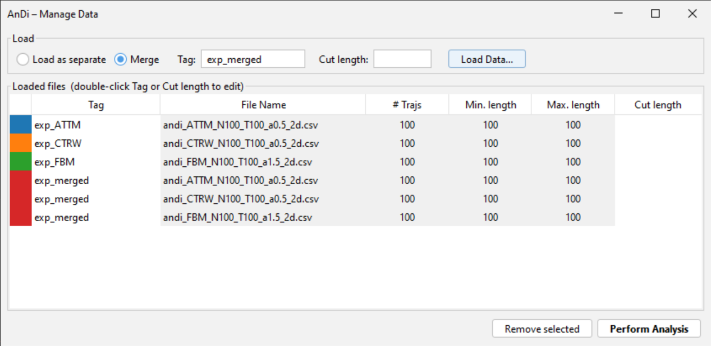
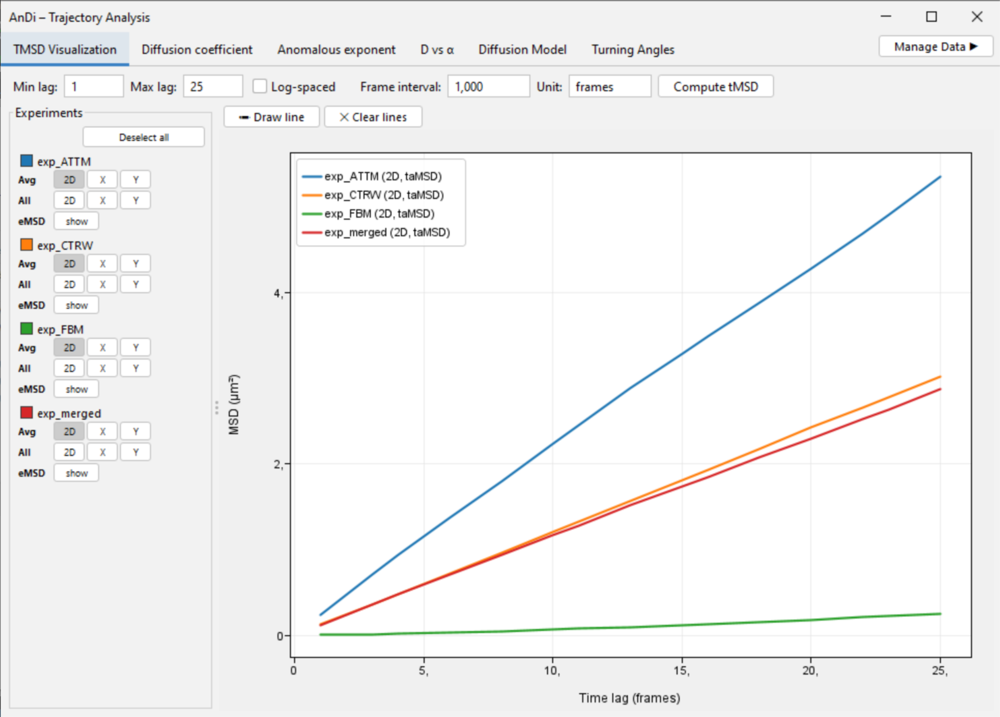

# AnDi Fiji

**AnDi Fiji** is a [Fiji](https://fiji.sc/)/ImageJ plugin for **anomalous‑diffusion analysis of single‑particle tracking (SPT) data**. Given input trajectories, it provides state-of-the-art machinery to analyze them, combining statistical  and machine learning (ML) analysis. The plugin works at two scales: from single trajectory analysis, returning properties for each of the input trajectories to "*per-frame*" predictions, allowing for a fine grained analysis and the segmentation of trajectories with expected diffusion changes.

> This page is the project documentation, written to be published as the GitHub
> **Wiki Home** page. See [Publishing this documentation](#publishing-this-documentation)
> at the bottom for how to push it, and [Screenshots to capture](#screenshots-to-capture)
> for the figures still to be added.

---

## Contents

- [Overview](#overview)
- [Installation](#installation)
- [Input data](#input-data)
- [Quick start](#quick-start)
- [The Data Manager](#the-data-manager)
- [Trajectory Analysis](#trajectory-analysis)
  - [tMSD Visualization](#tmsd-visualization)
  - [Diffusion coefficient](#diffusion-coefficient)
  - [Anomalous exponent](#anomalous-exponent)
  - [D vs α](#d-vs-α)
  - [Diffusion Model](#diffusion-model)
  - [Turning Angles](#turning-angles)
  - [PSD](#psd)
- [Trajectory Segmentation](#trajectory-segmentation)
  - [Visualization](#visualization)
  - [D vs α (density)](#d-vs-α-density)
  - [Segment Stats](#segment-stats)
- [Methods and definitions](#methods-and-definitions)
- [Machine‑learning models](#machine-learning-models)
- [Saved output files](#saved-output-files)
- [Building from source](#building-from-source)
- [Screenshots to capture](#screenshots-to-capture)
- [Publishing this documentation](#publishing-this-documentation)
- [References](#references)

---

## Overview

AnDi Fiji is organised around two menu commands under **`Plugins ▸ AnDi`**:

| Command | Purpose |
|---|---|
| **Trajectory Analysis** | Per‑trajectory observables: mean square displacement (MSD) analysis, diffusion coefficient *D*, anomalous exponent *α*, the *D*–*α* plane, diffusion‑model classification, and turning angles. |
| **Trajectory Segmentation** | Per‑frame predictions of *α* and *D* along each trajectory (STEP models) and change‑point detection that splits a trajectory into homogeneous segments. |

Both commands share the same **Data Manager** for loading and grouping data, and
both can analyse several experiments (conditions) at once, each with its own
colour, overlaid for comparison.

---

## Installation

**Requirements:** Fiji / ImageJ with Java 8+.

1. Build or download the plugin JAR `andi-fiji-0.0.2.jar` (see
   [Building from source](#building-from-source)).
2. Copy **both** of these into `Fiji.app/jars/`:
   - `andi-fiji-0.0.2.jar`
   - `onnxruntime-1.17.0.jar` (the ONNX Runtime dependency used for the
     machine‑learning predictions)
3. Restart Fiji. The commands appear under **`Plugins ▸ AnDi`**.

> The default deep‑learning models are bundled inside the plugin JAR as resources, so no extra download is required for ML predictions to work.

---

## Input data

AnDi Fiji gets as inputs `.csv` files containing the trajectories of a given experiment. To ease its combination with existing tools, the expected `.csv` must follow the standard layout of a [TrackMate](https://imagej.net/plugins/trackmate/) output: a header row, three further description/units rows, then one
row per spot. The required columns are:

| Column | Meaning |
|---|---|
| `TRACK_ID` | trajectory identifier |
| `POSITION_X`, `POSITION_Y` | spot coordinates (µm) |
| `FRAME` | frame index |
| `POSITION_T` | time (used to estimate the frame interval) |

Spots are grouped by `TRACK_ID` and sorted by frame; gaps in `FRAME` are handled
where relevant (e.g. MSD and eMSD lookups are gap‑aware).

> **Generating test data.** `pythons_helpers/andi_to_trackmate.py` use python and the library [`andi_datasets`](https://github.com/AnDiChallenge/andi_datasets) to produce example test `csv` files with trajectories in 1‑D or 2‑D, for any of the five diffusion models and a chosen anomalous exponent.


---

## The Data Manager

The Data Manager is the same for both Trajectory Analysis and Segmentation analysis, although each will open in different windows.

- **Load Data…** — add one or more CSV files (multi‑select).
- **Merge / Tag** — files sharing a tag are merged into a single *experiment*
  (condition); each tag gets a colour from a Tab10 palette.
- **Cut length** — per‑file trajectory‑length filter: trajectories shorter than
  *N* are dropped, longer ones are truncated to the first *N* points.
- The table shows, per file: colour, tag, file name, number of trajectories,
  min/max trajectory length, and cut length (tag and cut length are editable).
- **Perform Analysis** — assembles the experiments and opens the analysis window.
  In the Segmentation command this first runs the STEP models (with a progress
  bar over the number of trajectories).

The Data Manager can be accesses at any time during analysis, allowing to remove or add experiments at will.

> **Example:** below we have loaded test experiments (see above). The first three experiments were loaded as separate ones. Then, the same three experiments were loaded as a merged experiment, with a cut length of 10. The later will appear as a single experiment in the analysis.
<!-- IMAGE: data_manager.png -->


---

## Trajectory Analysis

A tabbed window. Every tab has a left/right **Experiments** panel where each
experiment can be toggled on/off and, where
relevant, restricted to the **2D**, **X**, or **Y** component.

### tMSD Visualization

This windows shows the time‑averaged MSD curves for each experiment, allowing for an initial visual inspection on the diffusive properties of the loaded experiments.

- Per‑experiment selectors for **Avg** (the average tMSD), **All** (every
  individual trajectory, faint), and **eMSD** (ensemble MSD, dashed).
- The lag axis is controlled by **Min lag**, **Max lag**, **Log‑spaced**, and a
  **Frame interval** / **Unit**. The number of lag points is chosen
  automatically (every integer lag when linear; capped, log‑spaced sampling when
  log‑spaced is selected). 
- **Draw line** lets you place a reference line and read its slope live; in
  log–log mode the slope is labelled *α*.
- **eMSD vs taMSD as an ergodicity test:** for ergodic processes the ensemble
  and time‑averaged MSD coincide; for non‑ergodic processes (e.g. CTRW) they
  diverge — eMSD ~ Δ^α while the time‑average tends toward a linear slope.
  Overlaying both (solid = taMSD, dashed = eMSD) makes weak ergodicity breaking
  visible at a glance.

> See **Analysing MSD** tutorial for tips on how to extract valuable information from this analysis.

<!-- IMAGE: tmsd_tab.png -->


### Diffusion coefficient

Estimates the diffusion coefficient *D* per trajectory from a linear fit of the
tMSD vs lag‑time (mirroring `andi_datasets` `get_diff_coeff`), shown as a
histogram. Independent **2D / X / Y** components, configurable time lags, frame
interval and unit.

<!-- IMAGE: diffusion_coeff_tab.png -->


### Anomalous exponent

Estimates the anomalous exponent *α* with **two interchangeable methods**,
selected from the **Method** drop‑down:

- **TMSD** — log–log fit of the tMSD curve (`α` = slope of log tMSD vs log lag).
- **ML** — the deep‑learning predictor (the V2 single‑trajectory model, see
  [Machine‑learning models](#machine-learning-models)). The ML computation runs
  in the background with a **progress bar over the number of trajectories**.

Results are shown as a histogram plus an **averages table**. The histogram
**Bins** control sits next to the plot and re‑bins instantly — it does **not**
re‑run the (potentially slow) ML computation.

> The ML method also predicts the diffusion‑model class in the same pass, so
> running it here automatically populates the **Diffusion Model** tab (and a
> confirmation dialog notes that both tabs were updated).

<!-- IMAGE: anomalous_exponent_tab.png -->


### D vs α

A scatter of **one point per trajectory** in the *D*–*α* plane (α from the
Anomalous‑exponent tab, *D* from the Diffusion‑coefficient tab; change the
parameters in those tabs).

- **Marginal KDEs** along the top (α) and right (*D*) edges, one curve per
  experiment, tracking zoom/pan.
- **Log D axis** toggle, rubber‑band **Zoom**, **Pan**, **Reset view**.
- **Population tagging.** In **Select** mode, *circle* (lasso) a cluster of
  points, type a name in **Population tag:** and click **Tag population**. The
  enclosed trajectories are recoloured to a shade of their parent colour and
  added as a new dataset to the **Turning Angles** and **Diffusion Model** tabs.
  A management table below the plot lists each population (tag, source datasets,
  colour — click the colour to change it).

<!-- IMAGE: d_vs_alpha_tab.png -->


### Diffusion Model

Classifies each trajectory into one of the five canonical anomalous‑diffusion
models — **ATTM, CTRW, FBM, LW, SBM** — using the V2 ML model, and shows a
**grouped bar chart** of the percentage of trajectories per experiment assigned
to each model.

- **Compute models (ML)** runs the classifier (progress bar over trajectories).
- **Save models…** exports the per‑trajectory predictions.

<!-- IMAGE: diffusion_model_tab.png -->


### Turning Angles

A **polar rose histogram** of turning angles between successive displacement
vectors (mirroring `andi_datasets` `dataset_angles`), pooled per experiment and
normalised to a fraction so experiments with different track counts are
comparable. Configurable bin count; **Save angles…** exports every angle.

<!-- IMAGE: turning_angles_tab.png -->


### PSD

Ensemble‑averaged **power spectral density** of the trajectories, adapting
`andi_datasets.analysis.psd` (which wraps `scipy.signal.periodogram` with its
defaults: unit sampling, boxcar window, constant detrend, one‑sided, density
scaling). For 2‑D the per‑dimension periodograms are summed.

- Each single‑trajectory periodogram is averaged over all trajectories of an
  experiment on a shared log‑frequency grid (from `1/max‑length` up to the
  Nyquist frequency 0.5). Only the **global average** is shown — no per‑track
  curves — with independent **2D / X / Y** selectors per experiment.
- **Freq. points** sets the number of frequency bins; **Log–log** toggles the
  axes.
- A **Draw line** tool (as in the tMSD tab) reports the slope of a reference
  line — useful since the PSD of an anomalous process scales as a power law in
  frequency (the spectral slope is related to the anomalous exponent).
- The frequency axis is in cycles per frame (sampling = 1), matching the
  `andi_datasets` default.

<!-- IMAGE: psd_tab.png -->


---

## Trajectory Segmentation

This command first runs the **STEP** models to predict, **for every frame** of
every trajectory, the local anomalous exponent *α* and local log₁₀(*D*). It then
applies **change‑point detection** to split each trajectory into homogeneous
segments. The window has three tabs.

> ℹ️ **Note:** an improved STEP model is in preparation and will replace the
> current per‑frame predictor; the workflow and outputs described here are
> unaffected.

### Visualization

A **4 × 4 grid** of per‑trajectory plots. Each plot shows the per‑frame
predictions as two time series — **α** (red, right axis, range [0, 2]) and
**log₁₀(D)** (blue, left axis, auto‑scaled) — plus the **change‑point
segmentation** overlaid as per‑segment mean step‑lines with dashed vertical
markers at the change points.

- **Sample random 16** picks 16 random trajectories; **Show trajectories…**
  opens a popup to enter specific TRACK_IDs.
- Independent toggles for **α**, **D**, **α_seg**, **D_seg** (e.g. hide the raw
  per‑frame lines and show only the segmentation).
- **Segmentation Parameters** opens a dialog to change the change‑point settings
  (penalty, minimum segment length, jump, rescale‑D); **Recalculate** re‑runs the
  detection and refreshes the plots.
- **Save segments…** exports one row per segment.

<!-- IMAGE: seg_visualization_tab.png -->


<!-- IMAGE: seg_parameters_dialog.png -->


### D vs α (density)

Because there is one (α, log₁₀D) prediction **per frame**, the joint
distribution is shown as a **2‑D density heatmap** rather than a scatter:

- α on X (fixed [0, 2]), log₁₀(D) on Y (auto‑ranged), colour = frame count
  (linear or **log count scale**), with a colour‑scale bar.
- Per‑experiment **marginal KDEs** (α top, log₁₀D right).
- Experiment multi‑select, configurable **Bins**.
- **Save data…** exports the per‑frame predictions (`track_id, frame, alpha, D`).

<!-- IMAGE: seg_dvsa_tab.png -->


### Segment Stats

Statistics computed from the change‑point segments, one point per segment:

- **Segment‑length histogram** (per experiment, overlaid outlines).
- **Segment length vs α** and **Segment length vs D** 2‑D density heatmaps,
  each with a side marginal KDE of the *y* variable (α on the left, *D* on the
  right). All three plots share the segment‑length *x* axis.

<!-- IMAGE: seg_stats_tab.png -->


---

## Methods and definitions

**Time‑averaged MSD (taMSD).** For one trajectory and lag Δ, the average squared
displacement over all time origins within that trajectory.

**Ensemble MSD (eMSD).** For lag Δ, the mean squared displacement from each
trajectory's first observed position, averaged across trajectories
(gap‑aware). The taMSD–eMSD comparison is an ergodicity diagnostic.

**Diffusion coefficient *D*.** Slope of a linear fit of taMSD vs lag time,
divided by `2·n_dim·Δt` (`n_dim` = 2 for 2D, 1 for X or Y).

**Anomalous exponent *α*.** Slope of a log–log fit of taMSD vs lag (TMSD method)
or the ML prediction (ML method). The averages table reports the α obtained by
fitting the **eMSD** curve, which is more robust for non‑ergodic processes.

**Turning angles.** Signed angle `atan2(cross, dot)` between successive
displacement vectors, mapped to [0, 2π); stationary steps are skipped.

**Change‑point detection.** A port of `ruptures.KernelCPD` with a *linear*
kernel: the linear‑kernel cost equals the within‑segment sum of squared
deviations from the mean, so detection reduces to multivariate change‑in‑mean.
We solve it exactly by dynamic programming minimising

```
Σ_segments cost(segment) + penalty · (number of change points)
```

on the stacked (rescaled log₁₀D, α) signal, with **minimum segment length** and
**jump** (candidate‑grid) constraints. Each segment stores its length, mean α
and mean log₁₀(D).

---

## Machine‑learning models

All inference runs on **CPU** via **ONNX Runtime**; the code is GPU‑ready
(switching the dependency to `onnxruntime_gpu` enables CUDA automatically). The
models share a common preprocessing: 2‑D Cartesian positions are converted to a
**relative‑polar** representation (displacement magnitude `dr` and turn angle
`dθ`), exactly matching the Python reference.

| Model | Used in | Output |
|---|---|---|
| **V2 single‑trajectory** | Anomalous exponent (ML), Diffusion Model | one *α* per trajectory **and** the diffusion‑model class (one network) |
| **STEP** (`step_alpha`, `step_logd`) | Trajectory Segmentation | per‑frame *α* and per‑frame log₁₀(*D*) |

The STEP per‑frame inference is **batched by sequence length** for speed (no
padding — trajectories of equal length are grouped into one inference call).

**ONNX conversion scripts** (`ML_analysis/pythons_for_plugin/`):

- `convert_single_traj_v2_to_onnx.py` → `single_traj_v2.onnx`
- `convert_step_to_onnx.py` → `step_alpha.onnx`, `step_logd.onnx`

After conversion, copy the `.onnx` files into `src/main/resources/models/` and
rebuild so they are bundled into the plugin JAR.

> **Diffusion‑model class order.** The classifier's five outputs map to
> `ATTM, CTRW, FBM, LW, SBM` in that order; this must match the model's training
> labels.

---

## Saved output files

All exports are CSV, with an extra leading `experiment` column when more than one
experiment is present.

| Where | Columns |
|---|---|
| Anomalous exponent → Save α | `traj_idx, alpha_2d, alpha_x, alpha_y` |
| Diffusion Model → Save models | `traj_idx, model` |
| Turning Angles → Save angles | `traj_idx, turning_angle_rad` (one row per angle) |
| Segmentation → Save segments | `track_id, segment, start_frame, length, alpha, D` |
| Segmentation D vs α → Save data | `track_id, frame, alpha, D` (per frame) |

---

## Building from source

```bash
# from the project root
mvn clean package
# → target/andi-fiji-0.0.2.jar
```

Deploy `andi-fiji-0.0.2.jar` **and** `onnxruntime-1.17.0.jar`
(`~/.m2/repository/com/microsoft/onnxruntime/onnxruntime/1.17.0/`) to
`Fiji.app/jars/`.

The project uses the standard `pom-scijava` parent (v36) and targets Java 8.

---

## Screenshots to capture

Images are referenced above as `images/<name>.png`. Capture each from the running
plugin and add it to the wiki (see [Publishing](#publishing-this-documentation)).
Suggested shots:

| File | What to show |
|---|---|
| `overview_menu.png` | The `Plugins ▸ AnDi` menu expanded. |
| `data_manager.png` | Data Manager with a few files loaded, tags/colours set. |
| `tmsd_tab.png` | tMSD tab with Avg (solid) + eMSD (dashed) for a non‑ergodic dataset, a drawn slope line. |
| `diffusion_coeff_tab.png` | *D* histogram for 2D, two experiments overlaid. |
| `anomalous_exponent_tab.png` | α histogram with **Method = ML**; show the Bins control near the plot. |
| `d_vs_alpha_tab.png` | *D*–α scatter with marginal KDEs **and** one tagged population (management table visible). |
| `diffusion_model_tab.png` | Diffusion‑model bar chart after **Compute models**, two experiments. |
| `turning_angles_tab.png` | Polar rose for one or two experiments. |
| `psd_tab.png` | PSD tab in log–log with a drawn slope line over the averaged curve. |
| `seg_visualization_tab.png` | 4×4 grid with α/D lines + segmentation step‑lines and change‑point markers. |
| `seg_parameters_dialog.png` | The Segmentation Parameters dialog. |
| `seg_dvsa_tab.png` | Per‑frame *D*–α density heatmap with colour bar + marginals. |
| `seg_stats_tab.png` | Segment‑length histogram + the two length‑vs‑(α,D) heatmaps. |

Optional: a **workflow figure** (TrackMate CSV → Data Manager → results) for the
Home page banner.

---

## Publishing this documentation

GitHub wikis are a separate Git repository. To publish this page as the wiki
**Home**:

1. On GitHub, open the repo's **Wiki** tab and create the first page (this
   creates the `*.wiki.git` repository).
2. Clone it and add this content as `Home.md`:
   ```bash
   git clone https://github.com/<user>/<repo>.wiki.git
   cp PAPER_NOTES.md <repo>.wiki/Home.md
   mkdir -p <repo>.wiki/images   # add the screenshots here
   cd <repo>.wiki && git add . && git commit -m "Add documentation" && git push
   ```
3. The in‑page links use heading anchors, so they work as a single page. If you
   prefer multiple pages, split the top‑level sections into separate `.md` files
   and add a `_Sidebar.md`.

> Image links use the relative path `images/<name>.png`; commit the screenshots
> to an `images/` folder in the wiki repository so they render.

---

## References

- AnDi Challenge & `andi_datasets`: <https://github.com/AnDiChallenge/andi_datasets>
- TrackMate: <https://imagej.net/plugins/trackmate/>
- `ruptures` (change‑point detection): <https://centre-borelli.github.io/ruptures-docs/>
- ONNX Runtime: <https://onnxruntime.ai/>
